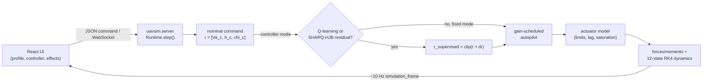

# Architecture

## System Boundary

Inside this repository: a Python 12-state rigid-body UAV simulator (`backend/src/uavsim/`),
a fixed/gain-scheduled autopilot, two residual command supervisors (tabular Q-learning and an
HJB/Bellman-inspired candidate evaluator), a FastAPI WebSocket server that runs the simulation
loop and streams telemetry, a React/Three.js frontend that sends commands and renders that
telemetry, an offline benchmark runner (`experiment_runner.py`), and the stored benchmark
outputs, tables and figures under `experiments/`.

Outside this repository: real flight hardware, hardware-in-the-loop rigs, and certified
flight-control software — none of this code has been flown (`README.md` "Scope boundary").
The SAAB Gripen STL mesh under `public/models/ro3code/` is a visual-only third-party asset with
documented provenance (`NOTICE`); it does not feed the physics or the benchmark numbers. There
is no pretrained model download and no external network dependency at runtime beyond the
frontend-to-backend WebSocket on localhost. The manuscript LaTeX source is explicitly **not**
in this repository — `PAPER.yml` declares `paper_of_record: false` and points
`latex_home: https://github.com/PhiniteLab/sharq-twin`; this repository is the companion-code
artifact for arXiv:2606.01397, and `backend/src/uavsim/` is declared the collection's
authoritative copy of the simulator (`PAPER.yml` notes).

## Components and Responsibilities

| Component | Responsibility | Consumes | Produces |
|---|---|---|---|
| `backend/src/uavsim/` | 12-state MAV dynamics, forces/moments, actuator model, wind/Dryden turbulence, fixed/gain-scheduled autopilot, guidance, Q-learning and SHARQ-HJB residual supervisors, FastAPI/WebSocket server | `backend/configs/aircraft/*.yaml`, live WebSocket commands | `simulation_frame` telemetry, benchmark CSV/JSONL, Q-table checkpoints (JSON/NPZ) |
| `backend/tests/` | Regression coverage for dynamics, controllers, residual supervisors, server frames | `backend/src/uavsim/` | pytest pass/fail (41 passed per `README.md`, `docs/testing.md`) |
| `src/` | React/TypeScript frontend: controls, operator/cinematic views, 3D scene, telemetry store | WebSocket `simulation_frame` messages | rendered UI, chart history |
| `public/` | Static frontend assets, including the visual-only SAAB Gripen STL meshes | — | served static assets |
| `scripts/` | `sync_results.py`, `export_tables.py`, `write_figures.py`, `check_paths.py` | `experiments/results/raw/` | `experiments/results/data/`, `experiments/results/tables/`, `experiments/results/figures/*.png` |
| `experiments/` | Canonical public experiment package: claims, raw/compact results, tables, figures | benchmark runner output | `experiments/claims/README.md`, `experiments/results/**` |
| `reproducibility/` | Hash manifest and a recorded validation run | repository tree | `MANIFEST.sha256`, `VALIDATION_2026-05-19.md` |
| `docs/` | Setup, running, architecture, backend, API, testing, development guides | — | human-facing documentation |
| `tests/browser-smoke.spec.ts` | Playwright browser smoke against the Vite dev server | running frontend + backend | pass/fail, not wired into CI |

## Runtime and Data Flow

Live/interactive path (`docs/architecture.md`, `backend/src/uavsim/server.py`):



Offline benchmark path (`backend/src/uavsim/experiment_runner.py`, `scripts/`):

```text
experiment_runner.run_batch(...)  ->  experiments/results/raw/<scenario>/<mode>/*.csv,*.jsonl
  -> scripts/sync_results.py      ->  experiments/results/data/*.csv,*.json
  -> scripts/export_tables.py     ->  experiments/results/tables/*.csv
  -> scripts/write_figures.py     ->  experiments/results/figures/*.png (12 figures)
```

`REPRODUCIBILITY.md` documents this exact three-script refresh chain plus the
`reproducibility/MANIFEST.sha256` regeneration step.

## State, Failure, and Recovery

Simulation randomness (wind/turbulence, Q-learning exploration) is seeded: both
`TabularQLearningSupervisor` and its configuration default `seed: int = 17`
(`backend/src/uavsim/q_learning.py:47,84,101`), constructed via `np.random.default_rng(seed)`.

Q-learning and SHARQ-HJB policies are checkpointable: both supervisors implement
`to_payload`/`from_payload` and `save_npz`/`load_npz`, and the round trip is asserted by
`test_q_learning_checkpoint_round_trip_json_and_npz` (`backend/tests/test_uavsim_core.py:230`).
`experiment_runner` accepts `checkpoint_in`/`checkpoint_out` so a batch run can resume from a
prior Q-table (`backend/tests/test_uavsim_core.py:389-419`).

The live WebSocket `Runtime` supports an explicit reset that clears profile-specific guidance
state while preserving wind/effect settings
(`test_runtime_reset_clears_profile_specific_guidance_state_and_preserves_wind_settings`,
`backend/tests/test_uavsim_server.py`); there is no automatic resume of an interrupted live
session beyond this manual reset — a dropped WebSocket connection loses in-memory runtime state.

No partial-run staging area exists for the offline benchmark path: `run_batch` writes directly
under `experiments/results/raw/<scenario>/<mode>/`, and a run that is interrupted mid-batch
leaves whatever episode files were already flushed; nothing in the repository detects or
resumes a partial batch automatically.

## Architectural Invariants

- The residual supervisors never command actuators directly; they only add a clipped residual
  to `[Va_c, h_c, chi_c]` ahead of the fixed/gain-scheduled autopilot
  (`experiments/claims/README.md` Claim 1; `backend/src/uavsim/server.py`, `autopilot.py`,
  `q_learning.py`, `sharq_hjb.py`).
- The residual action set is finite and bounded (no-op, ±2 m/s airspeed, ±10 m altitude,
  ±3 deg heading) and the adjusted command is clipped before reaching the autopilot
  (`experiments/claims/README.md` Claim 2).
- All three controller modes (`fixed_matlab_autopilot`, `online_q_learning`, `sharq_hjb`) run
  through the same plant, wind model, actuator model, autopilot, force/moment model, and
  12-state dynamics (`experiments/claims/README.md` Claim 3).
- `experiments/` is the single canonical result root; `README.md` states "No alternate result
  root is used in this release," and figure output is restricted to PNG only, itself checked in
  `reproducibility/VALIDATION_2026-05-19.md`.
- `backend/src/uavsim/` is the collection's authoritative simulator copy (`PAPER.yml` notes);
  other repositories carrying a copy of this package are expected to sync from here, not the
  reverse.

## Validation Architecture

| Layer | Purpose | Location |
|---|---|---|
| Backend unit/integration tests | Dynamics, autopilot, guidance, Q-learning, SHARQ-HJB, server-frame correctness | `backend/tests/test_uavsim_core.py`, `backend/tests/test_uavsim_server.py` — 41 passed (`README.md`, `docs/testing.md`) |
| Backend lint/type | Ruff + Pyright | `backend/pyproject.toml`, `backend/pyrightconfig.json`; run in CI |
| CI | lint, backend pyright, backend pytest, `check_paths.py` | `.github/workflows/ci.yml`, `Makefile` |
| Path/move-safety gate | Blocks a result/code move that breaks the collection's cross-repo links | `scripts/check_paths.py`, wired as `make check-paths` in CI |
| Frontend lint/build | TypeScript no-emit check + Vite build | `package.json` (`npm run lint`, `npm run build`) — **absent from CI**, recorded manually in `reproducibility/VALIDATION_2026-05-19.md` |
| Browser smoke | Playwright load/telemetry-bound checks | `tests/browser-smoke.spec.ts`, `npm run smoke:browser` — **absent from CI**, local/manual only |
| Manifest integrity | Hash check over the reproducibility sharing set | `reproducibility/MANIFEST.sha256`, `sha256sum -c` |
| Falsification | No bespoke counterexample suite; `make falsify` runs the backend pytest suite as the closest executable check | `Makefile` |

## Truth level

Measured by reading, not by executing: `README.md`, `docs/architecture.md`, `docs/testing.md`,
`REPRODUCIBILITY.md`, `reproducibility/VALIDATION_2026-05-19.md`, `PAPER.yml`, `Makefile`,
`.github/workflows/ci.yml`, `REPO-INFO/CODE-MAP.md`, `experiments/claims/README.md`, the
`backend/tests/*.py` test names and bodies, and `backend/src/uavsim/q_learning.py` for seed and
checkpoint behavior. The "41 passed" test count and every check listed in the Validation
Architecture table are copied from the repository's own recorded validation record
(`reproducibility/VALIDATION_2026-05-19.md`, `README.md`); this session did not execute
`pytest`, `ruff`, `npm run build`, or the benchmark runner, per the task's boundary against
running experiments. Comparative benchmark numbers referenced in `TRACEABILITY.md` were read
directly from `experiments/results/tables/*.csv`, not recomputed.
